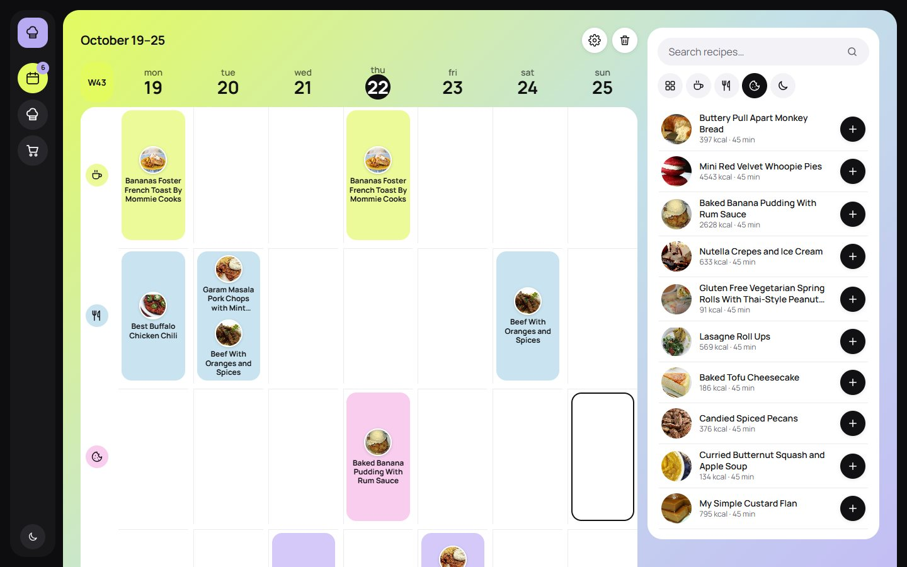

# Meal Planner

> Weekly meal planner with recipes from the Spoonacular API. Originally a FrontEnd project for the JOBarcelona IT Hackathon (2023), modernized in 2026.

[](https://github.com/wavesforweirdos/meal-planner/actions/workflows/ci.yml)
[](https://www.codefactor.io/repository/github/wavesforweirdos/meal-planner)

**Demo:** https://wavesforweirdos.github.io/meal-planner/



Three views, one at a time, without scrolling between sections: **Plan** (the week), **Recipes** (search and filters) and **Shopping list**. On desktop you build the week by dragging recipes from the side panel into the calendar (and between slots to move them); on tablets and phones you tap a slot and add recipes with one tap.

## Features

- Public home and recipe book: anyone can browse and filter recipes. The planner, shopping list and favourites only appear after signing in, and each account keeps its own data on the device
- Welcome intro on a first visit (or when you have never signed in): the animated rabbit mascot plays for four seconds on the gradient panel, then the sidebar buttons bud out of the panel's edge as liquid drops, each on its own path and timing (a CSS/SVG goo effect; it is skipped with `prefers-reduced-motion` and on phones)
- Brand: logo and loader are alpha masks, so one set of images follows the light and dark themes. Logo variants (face only, full mascot, horizontal wordmark) and sizes are chosen with props on the `Logo` component
- Sign in with Google or email through [Firebase Auth](https://firebase.google.com/docs/auth) (see "Sign-in setup" below). Without Firebase configuration the app runs in a demo mode with local, device-only profiles
- Shared plans: share the week and the shopping list with a link; everyone who joins edits the same plan and sees changes live. With Firebase it syncs between devices (Firestore, rules in `firestore.rules`); without it, demo mode syncs between tabs of the same browser. Leaving keeps your own copy
- Favourites: mark recipes with the heart and filter the Recipes view to show only them
- Minimal weekly calendar on a gradient panel: day tiles across the top (today highlighted) and meals from morning to night, each with its own colour and icon; recipes show as round plates; the plan is saved in your browser
- Icon-first interface: dark icon rail on desktop, line icons for actions, filters and navigation (names live in tooltips and for screen readers)
- Drag and drop on desktop: the recipe panel is always next to the calendar; drag a recipe into any slot, or from one slot to another. The panel also has an add / added button per recipe (for keyboard and touch), and tablets show the panel below the calendar
- Settings: rename the meals of the day, give each an emoji, add more (up to 8) and order them from morning to night; choose how many recipes each meal holds and the appearance (system, light or dark)
- Phone layout inspired by the iOS calendar: two days at a time with hidden horizontal scrolling, a day strip to jump around, a fixed "Add recipe" button that opens the recipes as a bottom sheet, and a floating bottom navigation bar
- Shopping list built from the planned recipes, grouped by supermarket aisle, with checkboxes and a "Copy list" button
- Recipe cards with calories, time, servings and price; detail view with ingredients and step-by-step instructions
- Search and filters by meal type and diet (vegetarian, vegan, gluten free, dairy free, healthy); the recipe list scrolls vertically on desktop and tablet, and is a swipeable carousel on phones
- Works out of the box with a set of sample recipes
- Optional: paste your own [Spoonacular API key](https://spoonacular.com/food-api) to search the whole catalogue. The key stays in your browser (`localStorage`) and is only sent to Spoonacular. If the request fails, the app falls back to the sample recipes and says so
- Views live in the URL hash (`#plan`, `#recipes`, `#shopping`), so the browser back button and direct links work on static hosting

## Accessibility

- Everything is available with the keyboard and with touch: dragging is optional, every slot is a focusable button and every recipe has an "Add" button
- Native modal dialogs (focus trap, `Esc` to close, focus returns to the trigger), labelled controls and filters that expose their state
- Focus moves to the view heading when you change view and, on phones, to the recipe sheet when it opens (and back to its button when it closes); the document title follows the view and plan changes are announced to screen readers
- Skip link, visible focus on every control and `prefers-reduced-motion` support; no accessibility violations reported by axe-core

## Technologies

| | |
|---|---|
| **Framework** | [React 19](https://react.dev/) |
| **Build tool** | [Vite 8](https://vite.dev/) |
| **Data** | [Spoonacular API](https://spoonacular.com/food-api) via `fetch` |
| **Styling** | [Sass](https://sass-lang.com/) with design tokens, [Manrope](https://fontsource.org/fonts/manrope); no inline styles (variants live in classes and `data-*` attributes) |
| **Quality** | [CodeFactor](https://www.codefactor.io/) |
| **CI/CD** | GitHub Actions and GitHub Pages |

## Sign-in setup

1. Create a Firebase project and add a Web app (Project settings > Your apps).
2. In Authentication > Sign-in method enable **Google** and **Email/Password**.
3. In Firestore Database create a database (production mode) and publish the rules from `firestore.rules` (needed only for shared plans).
4. In Authentication > Settings > Authorized domains add `wavesforweirdos.github.io` (and `localhost` for development).
5. Copy `.env.example` to `.env` and fill in the four `VITE_FIREBASE_*` values. For the GitHub Pages deploy add the same four values as repository secrets.

The Firebase keys identify the project and are not secret, but sign-in only works from authorised domains. Plan, favourites and settings are still stored in the browser, per account; syncing them across devices would need a database such as Firestore.

## Getting started

```sh
git clone https://github.com/wavesforweirdos/meal-planner
cd meal-planner
npm install
npm run dev
```

| Script | Description |
|---|---|
| `npm run dev` | Dev server with hot reload |
| `npm run build` | Production build into `dist/` |
| `npm run preview` | Preview the production build |
